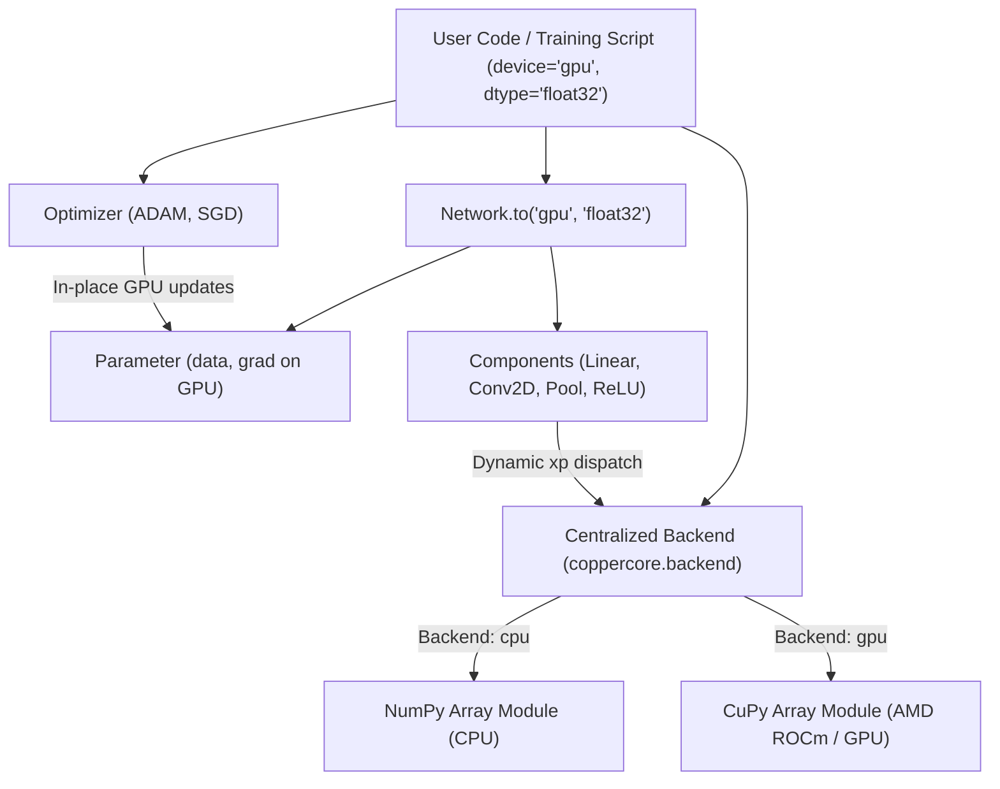

# Requirements

### Overview & Goals
Copperhead is a custom, from-scratch neural network framework built with NumPy to explore the mathematical foundations of deep learning and reinforcement learning. The objective of this project is to introduce optional GPU acceleration targeting AMD GPUs via ROCm using CuPy, while preserving Copperhead's custom mathematical implementation, educational clarity, and full CPU functionality.

### Scope
- **In Scope**:
  - Centralized array backend module supporting NumPy (CPU) and optional CuPy (GPU with ROCm).
  - Dynamic device-aware array dispatch (`get_array_module`, `to_device`, `to_numpy`, `set_backend`).
  - Device-aware `Parameter`, `Component`, `Structure`, and `Network` classes with `.to(device, dtype)` API.
  - Porting all computational components (`Linear`, `ReLU`, `Concat`, `Flatten`, `Conv2D`, `MaxPool2D`, `AvgPool2D`, `im2col`, `col2im`) to backend-agnostic operations.
  - Updating `SGD` and `ADAM` optimizers and loss functions to operate on device without implicit host transfers.
  - Configurable floating-point precision (defaulting to `float32` on GPU and supporting `float64`).
  - Adding optional GPU acceleration to MNIST and Snake DQN training pipelines (environment remains CPU, tensor math runs on GPU).
  - Automated tests with graceful skip when GPU/ROCm runtime is absent.
  - Benchmark script with proper GPU stream synchronization.
  - Comprehensive documentation covering CuPy + ROCm installation, device switching, and troubleshooting.
- **Out of Scope**:
  - Replacing custom layers with PyTorch, TensorFlow, JAX, or prebuilt neural network modules.
  - Writing custom low-level C++/HIP GPU kernels.
  - Mixed-precision (FP16/BF16) or automatic differentiation frameworks.
  - Changing the mathematical formulation of existing layers or RL algorithms.

### User Stories
- **As a researcher/student on CPU**, I want Copperhead to run seamlessly using standard NumPy without requiring CuPy or ROCm installed.
- **As a researcher with an AMD GPU (ROCm)**, I want to accelerate convolutional and dense training loops by toggling a device flag (`device="gpu"`) without rewriting network architectures.
- **As a framework user**, I want to move models between CPU and GPU (`model.to("gpu")`, `model.to("cpu")`) and execute training with `float32` precision for optimal throughput.

### Functional Requirements
1. **Default & Explicit Backend Selection**: Default to `"cpu"`. Allow explicit selection via `set_backend("cpu" | "gpu")` and querying via `get_backend()`.
2. **Missing Dependency Resilience**: Attempting to use GPU without CuPy or ROCm available must raise an informative `ImportError` or `RuntimeError` rather than silently failing or falling back.
3. **Array Module Dispatch**: Provide `get_array_module(array)` which dynamically returns `numpy` or `cupy` matching the array or the global backend if no array is passed.
4. **Device Transfer Utilities**:
   - `to_device(array, device, dtype=None)` transfers between CPU (numpy) and GPU (cupy).
   - `to_numpy(array)` reliably returns a standard CPU `np.ndarray`.
5. **Model & Parameter Device Management**:
   - `Parameter.to(device, dtype)` updates parameter data and gradients.
   - `Network.to(device, dtype)` recursively updates all constituent layers and weights.
6. **Optimizer State Migration**:
   - Optimizer moment accumulators (e.g. ADAM $m$ and $v$ vectors) match parameter device and dtype without implicit conversions.
7. **Spatial Operations on GPU**:
   - `Conv2D`, `MaxPool2D`, `AvgPool2D`, `im2col`, and `col2im` execute entirely on GPU using CuPy array routines and `xp.add.at` scatter accumulation.
8. **Precision Control**:
   - Support `float32` and `float64` across initializations, inputs, parameters, gradients, and optimizers.

### Non-Functional Requirements
- **Performance**: Zero unnecessary host-device data transfers during training forward/backward loops.
- **Maintainability**: Unified code paths for both CPU and GPU (no parallel `LinearCPU` vs `LinearGPU` classes).
- **Correctness**: Analytical and numerical equivalence between CPU and GPU forward/backward outputs within standard floating-point tolerances.

# Technical Design

### Current Implementation
Copperhead's core resides in `packages/coppercore/src/coppercore/`:
- `shared/types.py`: Defines type aliases `FloatArray = NDArray[np.float64]`, `IntArray`, `BoolArray`.
- `model_driven_nn/parameter.py`: Defines `Parameter(data, grad)` where `grad` is initialized with `np.zeros_like(data)`.
- `model_driven_nn/components/`: Classes (`Linear`, `ReLU`, `Conv2D`, `MaxPool2D`, `AvgPool2D`, `Concat`, `Flatten`, `im2col`) directly invoke `np.*` functions (`np.dot`, `np.maximum`, `np.pad`, `np.empty`, `np.add.at`).
- `optimizer/`: `SGD` and `ADAM` perform arithmetic directly on `parameter.data` and `parameter.grad`, with `ADAM` initializing `moment_1` and `moment_2` using `np.zeros_like`.
- `training/`: `mnist_train.py` and `dqn_train.py` use hardcoded NumPy operations for loss calculations and batch sampling.

### Key Decisions
1. **Dynamic Backend Dispatch Module (`coppercore.backend`)**:
   - *Decision*: Provide `get_array_module(*arrays)` that inspects the type of provided arrays (`cupy.ndarray` vs `numpy.ndarray`) or falls back to the configured active backend.
   - *Rationale*: Avoids stale module imports (`from backend import xp`) and prevents subtle errors if the backend changes dynamically during runtime.
2. **Unified Layer Architecture**:
   - *Decision*: Maintain single implementations of all layers that resolve `xp = get_array_module(x)` or `get_array_module(self.W.data)` at execution time.
   - *Rationale*: Prevents code duplication, preserves mathematical clarity, and ensures future features automatically support both CPU and GPU.
3. **Explicit Model Transfer API (`Network.to(device, dtype)`)**:
   - *Decision*: Implement `.to(device, dtype)` across `Parameter`, `Component`, `Structure`, and `Network`.
   - *Rationale*: Follows standard idioms while cleanly migrating data, gradients, and cached shapes.
4. **Replay Buffer & Training Separation for RL**:
   - *Decision*: Keep the Snake game environment and raw replay buffer on CPU; transfer sample batches to GPU immediately prior to model forward/backward steps.
   - *Rationale*: Reinforcement learning environments in Python are CPU-bound; keeping the environment on CPU prevents slow micro-transfers of single transitions while accelerating batch network updates.

### Proposed Changes
1. **Backend Infrastructure**:
   - Implement `packages/coppercore/src/coppercore/backend.py` with device detection, backend selection, array conversion, and type checks.
   - Re-export backend utilities through `coppercore.model_driven_nn.backend`.
2. **Type System Updates**:
   - Update `packages/coppercore/src/coppercore/shared/types.py` with generic array types (`ArrayLike`, `FloatArray`, `IntArray`) accommodating both `np.ndarray` and `cp.ndarray`.
3. **Layer & Parameter Modernization**:
   - Update `Parameter` to use `get_array_module(data)` for gradient initialization and zeroing.
   - Refactor `Linear`, `ReLU`, `Concat`, `Flatten`, `Conv2D`, `MaxPool2D`, `AvgPool2D`, `im2col`, and `col2im` to use dynamic `xp` dispatch.
4. **Optimizer & Loss Modernization**:
   - Update `ADAM` and `SGD` to allocate moment buffers on the parameter device.
   - Make loss functions (`softmax_cross_entropy_loss`, `dqn_mse`) backend-aware.
5. **Training Scripts & CLI**:
   - Add `--device` (`cpu` / `gpu`) and `--dtype` (`float32` / `float64`) CLI flags to `run_mnist.py`.
   - Update `mnist_train.py` and `dqn_train.py` to route training data to the selected device.

### Data Models / Contracts
```python

# coppercore/backend.py

def set_backend(name: str) -> None: ...
def get_backend() -> str: ...
def is_gpu_available() -> bool: ...
def get_array_module(*arrays) -> Any: ...  # returns numpy or cupy
def to_device(array: Any, device: str, dtype: Any = None) -> Any: ...
def to_numpy(array: Any) -> np.ndarray: ...

# coppercore/model_driven_nn/parameter.py

@dataclass
class Parameter:
    data: Any
    grad: Any

    @classmethod
    def from_data(cls, data: Any) -> "Parameter": ...
    def zero_grad(self) -> None: ...
    def to(self, device: str | None = None, dtype: Any = None) -> "Parameter": ...

# coppercore/model_driven_nn/network.py

class Network:
    def to(self, device: str | None = None, dtype: Any = None) -> "Network": ...
```

### File Structure
- `packages/coppercore/src/coppercore/backend.py` *(New)*: Centralized array backend.
- `packages/coppercore/src/coppercore/model_driven_nn/backend.py` *(New)*: Re-export alias.
- `packages/coppercore/src/coppercore/shared/types.py` *(Modified)*: Device-agnostic array types.
- `packages/coppercore/src/coppercore/model_driven_nn/parameter.py` *(Modified)*: Device-aware parameter.
- `packages/coppercore/src/coppercore/model_driven_nn/components/` *(Modified)*:
  - `base.py`, `linear.py`, `relu.py`, `conv.py`, `pool.py`, `im2col.py`, `concat.py`, `flatten.py`, `sequential.py`
- `packages/coppercore/src/coppercore/model_driven_nn/network.py` *(Modified)*: Added `.to()`.
- `packages/coppercore/src/coppercore/optimizer/` *(Modified)*:
  - `optimizer.py`, `sgd.py`, `adam.py`
- `packages/coppercore/src/coppercore/training/` *(Modified)*:
  - `mnist_train.py`, `run_mnist.py`, `dqn_train.py`
- `packages/coppercore/tests/` *(New/Modified)*:
  - `test_backend.py`, `test_gpu_layers.py`, `test_gpu_training.py`
- `benchmarks/benchmark_gpu.py` *(New)*: CPU vs GPU performance benchmark.
- `README.md` *(Modified)*: ROCm setup, CuPy installation, and usage instructions.

### Architecture Diagram


### Risks & Mitigations
- **CuPy not installed / missing ROCm drivers**: Backend will raise informative errors when `"gpu"` is requested and automatically default to NumPy for CPU execution without errors.
- **Numerical precision discrepancies in tests**: Use `np.allclose(atol=1e-4, rtol=1e-4)` for `float32` GPU tests and finite difference verification.
- **Accidental CPU/GPU mixing in operations**: Ensure `to_device()` validates inputs and all internal intermediate allocations use `xp = get_array_module(...)`.

# Testing

### Validation Approach
Verification will ensure that NumPy CPU execution remains 100% backward compatible without CuPy installed, and that when CuPy with ROCm is present, all layers, optimizers, and training loops produce mathematically accurate results with significant throughput acceleration.

### Key Scenarios
1. **CPU Default & Isolation**:
   - Run full existing test suite (`pytest`) on a pure CPU environment without CuPy. Verify 100% passing tests and zero regressions.
2. **Backend Switching & Error Handling**:
   - `set_backend("cpu")` works as expected.
   - `set_backend("gpu")` succeeds if CuPy is present, or raises `RuntimeError`/`ImportError` with clear installation guidance if missing.
3. **Model Device Transfers**:
   - Instantiate model on CPU -> call `model.to("gpu")` -> verify all parameter data and gradients are `cupy.ndarray`.
   - Call `model.to("cpu")` -> verify conversion back to `numpy.ndarray`.
4. **Numerical Parity (CPU vs GPU)**:
   - Run forward and backward passes on random seeds for `Linear`, `ReLU`, `Conv2D`, `MaxPool2D`, `AvgPool2D`, and `Concat`.
   - Compare CPU and GPU outputs via `to_numpy(gpu_out)` against `cpu_out` using appropriate tolerances (`rtol=1e-5, atol=1e-5` for float64, `1e-3` for float32).
5. **Optimizer Consistency**:
   - Run 10 iterations of `SGD` and `ADAM` on a multi-layer network on CPU and GPU; verify parameter trajectories match.
6. **End-to-End Training**:
   - Run 2 epochs of MNIST training on CPU and GPU; confirm loss decreases monotonically and validation accuracy matches expected benchmarks.
   - Execute Snake DQN updates on GPU batches and confirm stable Q-value convergence.

### Edge Cases
- **Missing CuPy Import**: Code must import cleanly and run tests on machines without CuPy.
- **0-padding and spatial edge conditions in Conv2D/Pool**: Verify padding with `-inf` (MaxPool) and `0.0` (AvgPool/Conv) works correctly in CuPy.
- **In-place indexing & scatter operations**: Verify `xp.add.at` in `col2im` correctly accumulates overlapping receptive fields on GPU.
- **Dtype Promotion**: Confirm `float32` inputs do not unintentionally get promoted to `float64` in layer math or optimizer moments.

### Test Changes
- `packages/coppercore/tests/test_backend.py`: Unit tests for backend selection, device transfer, and error handling.
- `packages/coppercore/tests/test_gpu_layers.py`: Equivalence tests for all components comparing CPU vs GPU outputs and gradient checks with `@pytest.mark.skipif(not is_gpu_available())`.
- `packages/coppercore/tests/test_gpu_training.py`: End-to-end MNIST training test on GPU.

# Delivery Steps

### ✓ Step 1: Implement Centralized Array Backend and Device-Aware Parameters
A centralized backend abstraction module (`coppercore.backend`) is operational with full CPU fallback and explicit GPU device support, and `Parameter` objects can move seamlessly between devices.

- Create `packages/coppercore/src/coppercore/backend.py` (and re-export via `coppercore.model_driven_nn.backend`) providing `set_backend()`, `get_backend()`, `get_array_module()`, `to_device()`, `to_numpy()`, and `is_gpu_available()`.
- Implement dynamic dispatch to CuPy when available, with clear error handling when GPU mode is requested without CuPy/ROCm installed.
- Update `packages/coppercore/src/coppercore/shared/types.py` to support device-agnostic array type annotations.
- Refactor `packages/coppercore/src/coppercore/model_driven_nn/parameter.py` to initialize gradients using `get_array_module(data).zeros_like(data)` and add `.to(device=None, dtype=None)` method.
- Update `packages/coppercore/pyproject.toml` to define optional GPU dependencies (`cupy-rocm` or general `cupy`).

### ✓ Step 2: Port Core Layers, Activations, and Spatial Convolutions to Backend
All model components and structures (Linear, ReLU, Concat, Flatten, Sequential, Conv2D, MaxPool2D, AvgPool2D, im2col/col2im) execute natively on either CPU or GPU without CPU roundtrips.

- Update `Component`, `Layer`, and `Structure` base classes in `packages/coppercore/src/coppercore/model_driven_nn/components/base.py` and `Network` in `network.py` with `.to(device, dtype)` propagation.
- Adapt `Linear` and `ReLU` in `linear.py` and `relu.py` to use `get_array_module()` for matrix operations (`dot`, `@`), broadcasting, activations, and boolean mask caching.
- Adapt `Concat` and `Flatten` in `concat.py` and `flatten.py` for device-agnostic array splitting, concatenation, and reshaping.
- Port `im2col` and `col2im` in `im2col.py` to use `xp.empty`, `xp.zeros`, and `xp.add.at` for index accumulation on GPU arrays without copying back to host memory.
- Adapt `Conv2D`, `MaxPool2D`, and `AvgPool2D` in `conv.py` and `pool.py` to perform padding (`xp.pad`), window extraction, reductions, and backpropagation directly on the active array module.

### ✓ Step 3: Update Optimizers and Loss Functions for Device Awareness
Optimizers (SGD, ADAM) and training loss functions maintain on-device state and compute updates with zero device-switching overhead.

- Update `Optimizer` base class in `packages/coppercore/src/coppercore/optimizer/optimizer.py` to support explicit device synchronization and `.to(device)` state transfer.
- Ensure `SGD` in `sgd.py` executes gradient updates in-place on whatever device holds the parameter tensors.
- Refactor `ADAM` in `adam.py` to initialize moment vectors on the parameter's device using `get_array_module(p.data).zeros_like` and support moving existing moment states between devices.
- Update `softmax_cross_entropy_loss`, `accuracy`, and `dqn_mse` in `coppercore/training/` to use array module dispatch for exponentials, reductions, and index-based gradient updates.

### ✓ Step 4: Add GPU Acceleration Support to MNIST and Snake Training
Training entry points for MNIST classification and Snake DQN accept configurable device/dtype settings and keep tensor workloads on the target device.

- Update `packages/coppercore/src/coppercore/training/mnist_train.py` and `run_mnist.py` to accept `--device` (cpu/gpu) and `--dtype` (float32/float64), transferring dataset batches to device once per iteration.
- Update `packages/coppercore/src/coppercore/training/dqn_train.py` to keep the Snake environment on CPU while transferring sampled replay buffer transition batches to GPU for policy and target network forward/backward passes.
- Ensure memory allocations and evaluations avoid redundant host-device transfers.

### ✓ Step 5: Implement Test Suite, Benchmarks, and ROCm Documentation
A comprehensive test suite verifies numerical consistency and device transfers, a benchmark measures GPU acceleration, and setup docs detail ROCm configuration.

- Add unit and gradient check tests in `packages/coppercore/tests/test_backend.py` and `test_gpu.py` testing CPU/GPU parity, precision changes (float32/float64), and gracefully skipping GPU tests when ROCm/CuPy is unavailable.
- Implement `benchmarks/benchmark_gpu.py` comparing CPU vs GPU execution times for Linear, Conv2D, Pooling, Adam step, and full training loops with proper stream synchronization (`cuda.Stream.null.synchronize()`).
- Update `README.md` with installation guides for AMD ROCm and CuPy, device switching examples, float32 vs float64 tradeoffs, and troubleshooting advice.