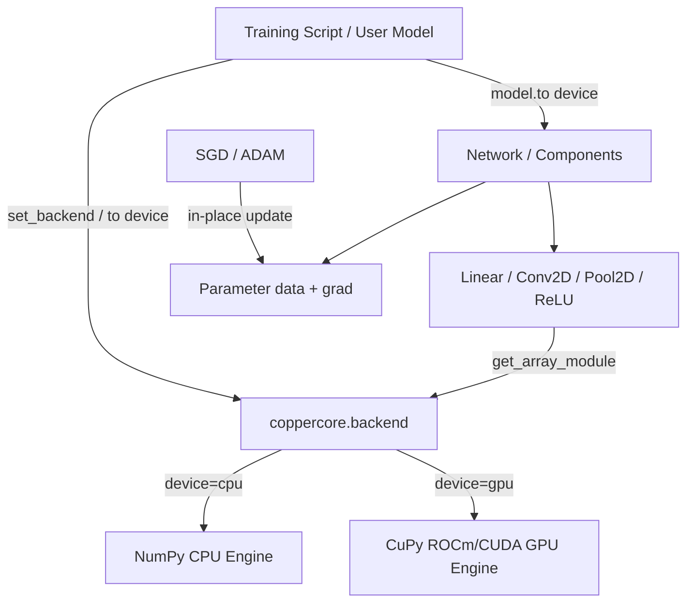

# Requirements

### Overview & Goals
Copperhead is a custom neural network framework written from scratch with educational mathematics. This project introduces optional GPU acceleration using CuPy (specifically targeting AMD GPUs via ROCm as well as NVIDIA GPUs via CUDA) while maintaining full backward compatibility with NumPy on CPU.

### Scope
- **In Scope:**
  - Create a centralized backend module (`coppercore.model_driven_nn.backend` and `coppercore.backend`) managing backend selection (`cpu` vs `gpu`), dynamic array module dispatch (`xp = get_array_module(x)`), device transfers (`to_device`, `to_numpy`), and dtype handling.
  - Device and precision awareness in `Parameter`, `Component`, and `Network` with `model.to("gpu")` and `model.to("cpu")` APIs.
  - Support for `float32` alongside `float64` precision.
  - Backend adaptation of core layers (`Linear`, `ReLU`, `Flatten`, `Concat`, `Conv2D`, `MaxPool2D`, `AvgPool2D`) and spatial routines (`im2col`, `col2im`).
  - Backend adaptation of optimizers (`SGD`, `ADAM`) maintaining state on the active device.
  - GPU-enabled training workflows in `mnist_train.py` and `dqn_train.py`.
  - Comprehensive unit testing with automatic GPU test skipping when CuPy/ROCm is unavailable.
  - Micro-benchmarks comparing CPU vs GPU execution times.
  - Documentation for installing ROCm-compatible CuPy and using the GPU backend.
- **Out of Scope:**
  - Introducing third-party deep learning frameworks (PyTorch, TensorFlow, JAX).
  - Writing raw C++/HIP kernels (CuPy vectorized operations and scatter routines are used).
  - Mixed precision (FP16/BF16) or automatic differentiation engines.
  - Mandatory CuPy dependency (NumPy CPU usage must remain 100% functional without CuPy installed).

### User Stories
- **As a researcher or student**, I want to train neural networks on my AMD/NVIDIA GPU using CuPy so that matrix multiplications and convolutions run substantially faster.
- **As a CPU user**, I want to use Copperhead without installing GPU drivers or CuPy so that the framework remains lightweight and zero-hassle.
- **As a developer**, I want to switch a model between CPU and GPU with `model.to("gpu")` / `model.to("cpu")` so that workflow transitions are clean and intuitive.

### Functional Requirements
- **Backend Management:**
  - `set_backend("cpu" | "gpu")` sets default execution backend.
  - `get_backend() -> str` returns active backend (`"cpu"` or `"gpu"`).
  - `get_array_module(x=None) -> ModuleType` returns `cupy` if `x` is a GPU array or global backend is `"gpu"`, else `numpy`.
  - `to_device(array, device, dtype=None)` safely transfers arrays between CPU and GPU.
  - `to_numpy(array)` returns a standard CPU NumPy array.
  - Graceful failure with helpful error message when `"gpu"` is requested without CuPy installed.
- **Model and Parameter Device Migration:**
  - `Parameter.to(device, dtype=None)` transfers `.data` and `.grad`.
  - `Component.to(device, dtype=None)` and `Network.to(device, dtype=None)` recursively migrate all parameters and subcomponents.
- **Layer & Optimizer Backend Compatibility:**
  - All layers (`Linear`, `Conv2D`, `MaxPool2D`, `AvgPool2D`, `ReLU`, `Flatten`, `Concat`) execute on the device where inputs and parameters reside.
  - `ADAM` moment buffers (`moment_1`, `moment_2`) are created and updated on the parameter's device.
- **Training Acceleration:**
  - MNIST training loop accepts `device="gpu"` and keeps batches/loss computations on the GPU.
  - Snake DQN keeps game logic on CPU while transferring mini-batches to GPU for Q-network learning.

### Non-Functional Requirements
- **Compatibility:** Full backward compatibility with existing NumPy CPU code.
- **Numerical Correctness:** CPU and GPU forward/backward outputs must match within floating-point tolerance (`1e-5` for float32, `1e-7` for float64).
- **Efficiency:** GPU tensors must remain on the device across consecutive layers and iterations without repeated host-device transfers.

# Technical Design

### Current Implementation
- `packages/coppercore/src/coppercore/model_driven_nn/parameter.py` wraps `np.ndarray` for `data` and `grad` without device awareness.
- Layers in `packages/coppercore/src/coppercore/model_driven_nn/components/` explicitly import `numpy as np` and use functions like `np.zeros`, `np.pad`, `np.add.at`, `np.maximum`, etc.
- `Conv2D` uses index-based `_im2col_indices` and `np.add.at` for `_col2im_indices`.
- `ADAM` initializes `moment_1` and `moment_2` using `np.zeros_like`.
- `mnist_train.py` and `dqn_train.py` perform all operations in CPU NumPy arrays.

### Key Decisions
1. **Dynamic Backend Dispatch vs XP Imports:**
   - *Decision:* Use `get_array_module(x)` / `get_backend()` rather than a static `from backend import xp`.
   - *Rationale:* Avoids stale module references when the backend is switched at runtime, and allows layers to operate on the device corresponding to the input tensor.
2. **Scatter/Accumulate Abstraction:**
   - *Decision:* Provide helper functions `scatter_add(dest, indices, src)` and `put_along_axis(dest, indices, values, axis)` in `backend.py`.
   - *Rationale:* NumPy uses `np.add.at` for in-place scatter addition while CuPy supports `cupyx.scatter_add` / `cp.add.at`. Abstracting this ensures `col2im` and `MaxPool2D` backward passes work seamlessly on both backends.
3. **Optional CuPy Dependency:**
   - *Decision:* Keep `cupy` out of required dependencies in `pyproject.toml`; provide optional extra `[project.optional-dependencies] gpu = [...]` and guide users on installing the appropriate ROCm / CUDA wheel for their system.
   - *Rationale:* ROCm wheels vary by ROCm version (`cupy-rocm-5-0`, `cupy-rocm-6-0`), so forcing a specific binary package in core dependencies breaks CPU-only installations.
4. **Precision Management:**
   - *Decision:* Support `float32` as the recommended default for GPU and configurable for CPU, while keeping `float64` fully supported.
   - *Rationale:* GPUs achieve peak throughput with single precision (`float32`), while scientific CPU code often uses `float64`.

### Proposed Changes

#### 1. Backend Module (`coppercore/model_driven_nn/backend.py`)
- Define backend state: `_CURRENT_BACKEND = "cpu"`, `_DEFAULT_DTYPE = np.float32`.
- `is_cupy_available() -> bool`.
- `set_backend(device: str) -> None`: validates availability when `"gpu"` is chosen.
- `get_backend() -> str`.
- `get_array_module(*arrays) -> ModuleType`: checks input arrays with `cupy.get_array_module` if available, or falls back to `_CURRENT_BACKEND`.
- `to_device(x, device, dtype=None)`: transfers between NumPy and CuPy, optionally casting dtype.
- `to_numpy(x)`: converts GPU/CPU array to `np.ndarray`.
- Backend helpers: `scatter_add(a, slices, b)`, `put_along_axis(arr, indices, values, axis)`.

#### 2. Parameter and Component Layer Updates
- `Parameter`:
  - Add `device` property, `to(device, dtype=None)`.
  - Ensure `.grad` matches `.data` device and precision.
- `Component` / `Structure` / `Network`:
  - Add `.to(device, dtype=None)` method to recursively migrate parameters and child components.
  - Refactor `Linear`, `ReLU`, `Flatten`, `Concat`, `Conv2D`, `MaxPool2D`, `AvgPool2D` to obtain array module via `get_array_module(x)` and use backend scatter/indexing utilities.

#### 3. Optimizer Updates (`SGD`, `ADAM`)
- `SGD`: in-place updates `p.data -= lr * p.grad` work transparently on both NumPy and CuPy arrays.
- `ADAM`: initialize `moment_1`, `moment_2` using `xp = get_array_module(p.data)` and `xp.zeros_like(p.data)`. Implement `.to(device)` / state reset when parameters are migrated.

#### 4. Training Pipelines
- `mnist_train.py`: accept `device="cpu" | "gpu"` and `dtype="float32" | "float64"`. Transfer batch data once per iteration, compute `softmax_cross_entropy_loss` on device using `xp = get_array_module(logits)`.
- `dqn_train.py`: maintain replay buffer on CPU, transfer sample batches `(state, next_state)` to GPU during `dqn_update`.

### Data Models / Contracts

```python

# backend.py signature outline

def is_cupy_available() -> bool: ...
def set_backend(device: Literal["cpu", "gpu"]) -> None: ...
def get_backend() -> Literal["cpu", "gpu"]: ...
def get_array_module(*arrays: Any) -> Any: ...
def to_device(array: Any, device: Literal["cpu", "gpu"], dtype: Any = None) -> Any: ...
def to_numpy(array: Any) -> np.ndarray: ...
def scatter_add(target: Any, indices: Any, source: Any) -> None: ...

# Parameter API extension

class Parameter:
    data: Any
    grad: Any
    @property
    def device(self) -> str: ...
    @property
    def dtype(self) -> Any: ...
    def to(self, device: str, dtype: Any = None) -> "Parameter": ...

# Network API extension

class Network:
    def to(self, device: str, dtype: Any = None) -> "Network": ...
```

### File Structure
- `packages/coppercore/src/coppercore/model_driven_nn/backend.py` (New): Central array backend implementation.
- `packages/coppercore/src/coppercore/backend.py` (New): Convenience re-export.
- `packages/coppercore/src/coppercore/shared/types.py` (Modified): Generalized array type hints.
- `packages/coppercore/src/coppercore/model_driven_nn/parameter.py` (Modified): Device and dtype management.
- `packages/coppercore/src/coppercore/model_driven_nn/components/base.py` (Modified): `.to()` propagation.
- `packages/coppercore/src/coppercore/model_driven_nn/components/linear.py` (Modified): Array module dispatch.
- `packages/coppercore/src/coppercore/model_driven_nn/components/relu.py` (Modified): Array module dispatch.
- `packages/coppercore/src/coppercore/model_driven_nn/components/conv.py` (Modified): Backend-aware `im2col`/`col2im`.
- `packages/coppercore/src/coppercore/model_driven_nn/components/pool.py` (Modified): Backend-aware pooling.
- `packages/coppercore/src/coppercore/model_driven_nn/components/flatten.py` (Modified): Reshape preservation.
- `packages/coppercore/src/coppercore/model_driven_nn/components/concat.py` (Modified): Concatenation dispatch.
- `packages/coppercore/src/coppercore/model_driven_nn/network.py` (Modified): `.to(device)` implementation.
- `packages/coppercore/src/coppercore/optimizer/adam.py` (Modified): Device-aware moments.
- `packages/coppercore/src/coppercore/training/mnist_train.py` (Modified): Device-aware training loop.
- `packages/coppercore/src/coppercore/training/dqn_train.py` (Modified): Batch transfer for DQN.
- `benchmarks/benchmark_backend.py` (New): Micro-benchmarks for CPU vs GPU.
- `packages/coppercore/tests/test_backend.py` (New): Backend unit tests.
- `packages/coppercore/tests/test_gpu_compat.py` (New): CPU/GPU equivalence & layer tests.

### Architecture Diagram


### Risks & Mitigations
- **Risk:** CuPy is not installed on CPU-only machines.
  - *Mitigation:* Lazily import CuPy and trap `ImportError`. All CPU operations run purely on NumPy.
- **Risk:** In-place slicing differences between NumPy and CuPy in `col2im` and `MaxPool2D`.
  - *Mitigation:* Implement standard backend wrapper `scatter_add` using `cupyx.scatter_add` / `cp.add.at` / `np.add.at`.
- **Risk:** Unintentional CPU-GPU array mixing causing runtime errors.
  - *Mitigation:* Ensure `to_device` is used consistently at network boundaries (e.g. dataset loader to network input) and parameters stay on designated device.

# Testing

### Validation Approach
Automated testing using `pytest` will validate the implementation. Tests will run on CPU by default and conditionally execute GPU test cases whenever CuPy and a compatible GPU/ROCm runtime are present (using `@pytest.mark.skipif(not is_cupy_available(), reason="CuPy not available")`).

### Key Scenarios
1. **Backend API Verification:**
   - Setting backend to `"cpu"` and querying `get_backend()` returns `"cpu"`.
   - Setting backend to `"gpu"` without CuPy raises `RuntimeError` with informative installation instructions.
   - `to_device` and `to_numpy` round-trips preserve array shapes and values.
2. **Layer Forward and Backward Computations:**
   - Verify `Linear`, `ReLU`, `Flatten`, `Concat`, `Conv2D`, `MaxPool2D`, `AvgPool2D` produce identical outputs on CPU and GPU given identical initial weights and inputs.
3. **Finite Difference Gradient Verification:**
   - Numerical gradient check on `Conv2D`, `Linear`, `MaxPool2D`, and `AvgPool2D` verifying analytical backward gradients match finite difference approximations on both CPU and GPU.
4. **Optimizer Updates:**
   - Validate `SGD` and `ADAM` step updates on parameters across multiple iterations on both backends.
5. **Model Device Migration:**
   - Instantiate a `Network`, call `model.to("gpu")`, verify all layer weights and biases reside on GPU, call `model.to("cpu")`, verify back on CPU.
6. **Floating-point Precisions:**
   - Verify all layers and loss calculations run cleanly with both `float32` and `float64` without unexpected dtype promotion.

### Edge Cases
- Calling `model.backward()` before `forward()` raises proper `RuntimeError`.
- `MaxPool2D` with duplicate maximum values backward scatter works deterministically.
- Transferring optimizer state when model device changes.
- 0-dim or 1-dim bias handling in convolution/dense layers.

### Test Changes
- `packages/coppercore/tests/test_backend.py`: tests for backend module and error handling.
- `packages/coppercore/tests/test_gpu_compat.py`: cross-backend consistency tests, gradient checks, and device migration tests.
- Existing `test_conv.py` and `test_smoke.py`: remain fully functional on CPU with 100% pass rate.

# Delivery Steps

### * Step 1: Implement the Array Backend and Precision Management Module
Implement the core array abstraction in `packages/coppercore/src/coppercore/model_driven_nn/backend.py` (and re-export from `coppercore.backend`) to support NumPy and optional CuPy with ROCm/CUDA.

- Implement `Backend` enum / literal types (`"cpu"`, `"gpu"`), `set_backend(device)`, `get_backend()`, and `get_array_module(array_or_device)`.
- Implement safe optional import for `cupy` (and `cupyx`), raising descriptive `RuntimeError` with ROCm installation tips if GPU backend is requested without CuPy.
- Implement tensor transfer utilities: `to_device(array, device, dtype=None)` and `to_numpy(array)`.
- Implement backend-agnostic tensor utility functions for scatter/gather operations (such as `scatter_add` / `add_at` and `put_along_axis`) that resolve differences between NumPy and CuPy.
- Update `packages/coppercore/src/coppercore/shared/types.py` to define device-agnostic array type aliases (`FloatArray`, `IntArray`, `BoolArray`) and supported precision types (`float32`, `float64`).
- Add unit tests for backend registration, error handling when CuPy is absent, device switching, and array conversions.

###   Step 2: Device and Dtype Awareness for Parameters and Components
Extend `Parameter`, `Component`, and `Network` classes to support explicit device placement and dtype conversions.

- Update `packages/coppercore/src/coppercore/model_driven_nn/parameter.py` with `device` and `dtype` properties, `.to(device, dtype=None)` method, and ensure `grad` matches `data` device and precision.
- Update `packages/coppercore/src/coppercore/model_driven_nn/components/base.py` to add `.to(device, dtype=None)` on `Component` and `Structure` to recursively migrate sub-components and parameters.
- Update `packages/coppercore/src/coppercore/model_driven_nn/network.py` to implement `model.to(device, dtype=None)` and ensure device metadata is tracked.
- Add unit tests verifying parameter migration, gradient initialization on correct device, and zero-grad behavior across CPU and GPU.

###   Step 3: Port Dense Layers, Activations, and Optimizers
Port `Linear`, `ReLU`, `Flatten`, `Concat`, and optimizers (`SGD`, `ADAM`) to use the array backend without losing mathematical fidelity.

- Update `Linear` layer forward (`x @ W.T + b`) and backward (`d_y.T @ x`, `d_y @ W`, bias sum) to use the backend of the input/weights.
- Update `ReLU`, `Flatten`, and `Concat` to execute using array module dispatch (`xp.maximum`, `xp.concatenate`, `xp.reshape`).
- Update `packages/coppercore/src/coppercore/optimizer/sgd.py` to operate in-place across parameters on any device.
- Update `packages/coppercore/src/coppercore/optimizer/adam.py` to initialize moment vectors (`moment_1`, `moment_2`) on the parameter's device/dtype and implement `.to(device)` / state reset when parameter devices change.
- Add tests for dense layer forward/backward passes and optimizer state updates on CPU and GPU (conditionally skipped).

###   Step 4: Accelerate Convolution and Pooling Layers
Refactor convolution, pooling, and spatial index transforms to execute on CPU and GPU without host-device transfer bottlenecks.

- Update `packages/coppercore/src/coppercore/model_driven_nn/components/conv.py` (`Conv2D`, `_im2col_indices`, `_col2im_indices`) to use array backend indexing, array generation (`xp.arange`, `xp.pad`), and backend `scatter_add` / `add_at`.
- Update `packages/coppercore/src/coppercore/model_driven_nn/components/pool.py` (`MaxPool2D`, `AvgPool2D`) to perform pooling transforms and argmax backpropagation entirely on the active device.
- Ensure all intermediate buffers (`_cols`, `_x_shape`, masks) stay on device during forward and backward passes.
- Add finite-difference gradient check tests for `Conv2D`, `MaxPool2D`, and `AvgPool2D` verifying mathematical correctness across CPU and GPU.

###   Step 5: Update MNIST and Snake Training Pipelines
Integrate optional GPU acceleration into MNIST classification and Snake Reinforcement Learning training pipelines.

- Update `packages/coppercore/src/coppercore/training/mnist_train.py` with `device` and `dtype` parameters in `train()`, transferring batch inputs/labels to device, computing cross-entropy loss on device, and avoiding redundant weight transfers.
- Update `packages/coppercore/src/coppercore/training/dqn_train.py` and `dqn_harness.py` to keep environment steps on CPU while transferring sampled replay buffer batches to GPU for Q-network updates.
- Verify end-to-end training execution on CPU and test GPU code paths with conditional execution.

###   Step 6: Benchmarking, Testing, and Documentation
Deliver comprehensive test suite, performance benchmarks, and user documentation for CuPy + ROCm acceleration.

- Add unit and integration tests in `packages/coppercore/tests/` verifying CPU NumPy functionality, optional CuPy GPU execution, CPU/GPU numerical consistency, missing dependency handling, and dtype compatibility (`float32`/`float64`).
- Implement benchmark script `benchmarks/benchmark_backend.py` measuring execution time for Dense, Conv, Pooling, Optimizer steps, and MNIST training batches with GPU synchronization.
- Update `README.md` and documentation with ROCm CuPy installation commands, hardware prerequisites, `model.to("gpu")` usage, float32 recommendations, and troubleshooting tips.