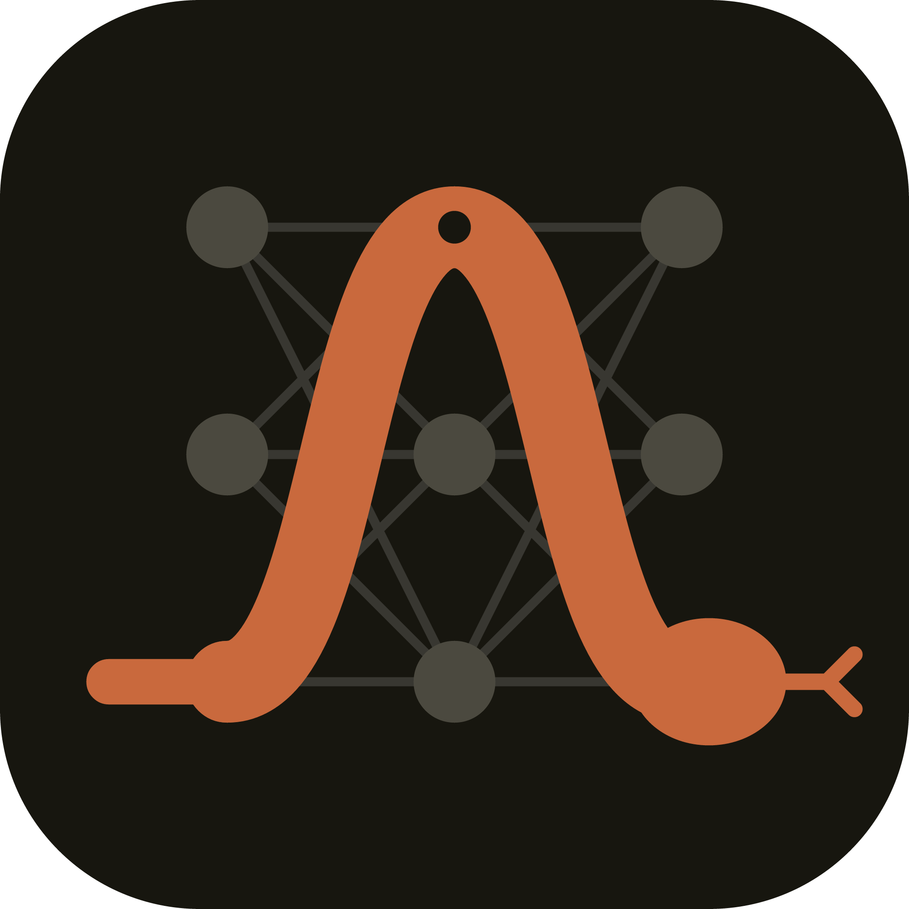

# Copperhead

<div align="center">


[](https://opensource.org/licenses/MIT)
[](https://www.python.org/downloads/)




</div>

<details>
<summary><strong>📋 Table of Contents</strong></summary>

- [Description](#description)
- [Prerequisites](#prerequisites)
- [Getting Started](#getting-started)
  - [CPU Setup](#cpu-setup-default)
  - [AMD GPU (ROCm) Setup](#amd-gpu-rocm-setup)
  - [NVIDIA GPU (CUDA) Setup](#nvidia-gpu-cuda-setup)
- [Hardware & Device Switching API](#hardware--device-switching-api)
  - [Backend Configuration](#backend-configuration)
  - [Device-Aware Models and Parameters](#device-aware-models-and-parameters)
  - [Precision: Float32 vs Float64](#precision-float32-vs-float64)
- [Usage & Training](#usage--training)
  - [Random Snake Agent](#random-snake-agent)
  - [MNIST Classification](#mnist-classification)
  - [Snake Reinforcement Learning (DQN)](#snake-reinforcement-learning-dqn)
- [Network Serialization and Model Saving](#network-serialization-and-model-saving)
- [Optimizer State Serialization](#optimizer-state-serialization)
- [Benchmarking](#benchmarking)
- [Documentation](#documentation)
- [Testing](#testing)
- [Troubleshooting](#troubleshooting)
- [Team](#team)
- [License](#license)

</details>

## Description

**Copperhead** is a [Cogito NTNU](https://github.com/CogitoNTNU) project exploring the mathematical foundations of deep learning and reinforcement learning, including teaching agents to play Snake. Its shared Python package, [`coppercore`](packages/coppercore), contains the neural-network framework, Snake environment, replay buffers, DQN agents, and training utilities. Team members' experiments live under [`projects/`](projects).

The framework includes:

- **From-scratch mathematics:** Linear transformations, ReLU activations, spatial convolutions (`Conv2D`), pooling (`MaxPool2D`, `AvgPool2D`), reshaping and composition (`Flatten`, `Concat`), and `im2col` / `col2im` operations.
- **Flexible backends:** NumPy on CPU by default, with optional CuPy acceleration on supported AMD ROCm or NVIDIA CUDA configurations.
- **Device-aware computation:** GPU network forward passes, loss calculations, backpropagation, and optimizer steps operate on device arrays, avoiding unnecessary host transfers within those operations.
- **Model-driven networks:** A YAML `Builder` / `Loader` for declaratively constructing network architectures.
- **Model serialization:** Export YAML architectures and learned weights, then reconstruct saved models.
- **Optimizer serialization:** Save and restore SGD configuration or Adam's running moments and timestep.

______________________________________________________________________

## Prerequisites

- **Git:** [Install Git](https://git-scm.com/downloads).
- **Python 3.12:** [Download Python](https://www.python.org/downloads/).
- **uv:** Used for dependency and workspace management. [Install uv](https://docs.astral.sh/uv/getting-started/installation/).
- **Docker (optional):** Useful for DevContainer development. [Download Docker](https://www.docker.com/products/docker-desktop/).
- **AMD GPU only (optional):** ROCm drivers and `rocm-smi` for supported AMD hardware.
- **NVIDIA GPU only (optional):** Compatible NVIDIA drivers and CUDA 12.x support.

______________________________________________________________________

## Getting Started

Clone the repository:

```bash
git clone https://github.com/CogitoNTNU/Copperhead.git
cd Copperhead
```

### CPU Setup (Default)

The CPU backend uses NumPy and does not require GPU packages:

```bash
uv sync
```

For development, install the Git hooks:

```bash
uv run pre-commit install
```

### AMD GPU (ROCm) Setup

Verify that the ROCm driver recognizes your AMD GPU:

```bash
rocm-smi
```

For ROCm 7.x, use the optional ROCm dependency group:

```bash
uv sync --extra rocm
# Alternatively, when installing coppercore independently:
pip install 'coppercore[rocm]'
```

For ROCm 5.x, the project documents this wheel option:

```bash
uv pip install 'cupy-rocm-5-0>=13.0.0'
```

For custom ROCm configurations that require compiling CuPy with HIP support, an example is:

```bash
CUPY_INSTALL_USE_HIP=1 ROCM_HOME=/opt/rocm HCC_AMDGPU_TARGET=gfx1100 uv pip install cupy
```

Check the compatibility of your ROCm version, GPU architecture, and CuPy package before installing. Do not install multiple CuPy variants into the same environment.

### NVIDIA GPU (CUDA) Setup

For an NVIDIA GPU with a compatible CUDA 12.x driver:

```bash
uv sync --extra cuda
# Alternatively, when installing coppercore independently:
pip install 'coppercore[cuda]'
```

When working across all packages in the monorepo, you can include `--all-packages`:

```bash
uv sync --all-packages --extra cuda
```

______________________________________________________________________

## Hardware & Device Switching API

### Backend Configuration

The default backend is `"cpu"` (NumPy). Query or change it with:

```python
from coppercore.backend import get_backend, is_gpu_available, set_backend

print(get_backend())  # "cpu" by default
print(is_gpu_available())  # Whether an available CuPy GPU runtime is detected

set_backend("gpu")  # Requires a working GPU backend
```

### Device-Aware Models and Parameters

Networks and optimizers support device and dtype migration:

```python
import numpy as np

from coppercore.model_driven_nn import Network
from coppercore.model_driven_nn.components import Linear, ReLU, Sequential
from coppercore.optimizer import ADAM

network = Network(
    name="mlp",
    model=Sequential([Linear(784, 128), ReLU(), Linear(128, 10)]),
    input_dim=784,
    output_dim=10,
)

optimizer = ADAM(learning_rate=1e-3)
optimizer.parameters = network.params()

# Move the network and optimizer to GPU with float32 precision.
network.to(device="gpu", dtype=np.float32)
optimizer.to(device="gpu", dtype=np.float32)

# Move back to CPU with float64 precision.
network.to(device="cpu", dtype=np.float64)
optimizer.to(device="cpu", dtype=np.float64)
```

### Precision: Float32 vs Float64

- **GPU:** `float32` is usually preferable for throughput and lower VRAM usage.
- **CPU:** `float64` is useful for numerical verification and finite-difference gradient checks.

______________________________________________________________________

## Usage & Training

### Random Snake Agent

Run a random agent to inspect the Snake environment:

```bash
uv run python -m coppercore.dqn.run_random_snake
```

See the [Snake environment README](packages/coppercore/src/coppercore/dqn/README.md) for additional environment and agent details.

### MNIST Classification

Train a YAML-defined network on MNIST:

```bash
# CPU training
uv run run-mnist --network packages/coppercore/networks/v1.yaml --epochs 5 --device cpu

# GPU training in float32
uv run run-mnist --network packages/coppercore/networks/v1.yaml --epochs 10 --device gpu --dtype float32
```

### Snake Reinforcement Learning (DQN)

The convolutional Snake DQN agent supports CPU training and optional GPU acceleration.

- **Architecture:** A `Conv2D` feature extractor (16 channels), `ReLU`, and `Flatten`, followed by fully connected layers of sizes 128, 64, and 4 with ReLU activations.
- **CPU/GPU partitioning:** The Snake environment and replay buffer remain on CPU. Sampled training mini-batches move to GPU for batched forward and backward passes.
- **Action selection:** `act()` processes an observation and returns an action; random exploration can skip network inference.
- **Batch size:** `128` or `256` is a useful starting point. Benchmark your configuration, since the fastest batch size depends on the workload and hardware.

Run training from the repository root:

```bash
# CPU (default)
uv run python projects/convolution/src/convolution/main.py \
  --device cpu --dtype float32 --batch-size 128

# GPU, using either a configured ROCm or CUDA backend
uv run python projects/convolution/src/convolution/main.py \
  --device gpu --dtype float32 --batch-size 128 --n-steps 800000
```

Programmatic example:

```python
import numpy as np
from convolution.main import DQNAgent, make_snake_env

env = make_snake_env()

agent = DQNAgent(
    n_states=env.n_states,
    n_actions=env.n_actions,
    obs_shape=env.obs_shape,
    device="gpu",  # or "cpu"
    dtype=np.float32,  # or np.float64
    batch_size=128,
)
```

______________________________________________________________________

## Network Serialization and Model Saving

Copperhead can save a network's architecture to YAML, its learned parameters to NPZ, or both together in a model directory. Architecture reconstruction reuses the existing YAML Builder / Loader.

### Save and Load a Complete Model

```python
from coppercore.model_driven_nn.network import Network

network.save_model("models/my-network")

# Reconstruct the architecture and restore its learned weights.
restored = Network.load_model("models/my-network")
```

The saved model directory contains:

```text
models/my-network/
├── manifest.json
├── model.yaml
└── weights.npz
```

### Save the Architecture Separately

```python
from coppercore.model_driven_nn.construction.loader import Loader

network.save_architecture("architecture.yaml")
restored = Loader().load("architecture.yaml")
```

An architecture-only load constructs fresh parameters; it does **not** restore trained weights.

### Save and Load Weights Separately

```python
network.save_weights("weights.npz")
network.load_weights("weights.npz")
```

Loading weights into an existing network validates the expected parameter names and shapes. Network serialization does not include the optimizer's internal state or the rest of a training run.

______________________________________________________________________

## Optimizer State Serialization

Copperhead supports saving and restoring `ADAM` and `SGD` optimizer state. Adam preserves its first- and second-moment estimates, timestep, and hyperparameters. Plain SGD has no moment buffers, so its state only needs its configuration (such as the learning rate).

### Save Network and Optimizer

Pass the network to the optimizer when saving so Adam's moment arrays can be associated with stable parameter names:

```python
network.save_model("checkpoints/network")
optimizer.save_state("checkpoints/optimizer", network)
```

### Restore Network and Optimizer

Restore the network first, then associate the optimizer with its parameters before loading its saved state:

```python
from coppercore.model_driven_nn.network import Network
from coppercore.optimizer.adam import ADAM

network = Network.load_model("checkpoints/network")

optimizer = ADAM()
optimizer.parameters = network.params()
optimizer.load_state("checkpoints/optimizer", network)

# Continue optimization with the restored moments and timestep.
```

Parameter names are used for serialization, not maintained as a second optimizer binding during ordinary training.

### In-Memory State Dictionaries

```python
state = optimizer.state_dict(network)
optimizer.load_state_dict(state, network)
```

### What's Included?

| Optimizer | Saved state                                                                          |
| --------- | ------------------------------------------------------------------------------------ |
| `ADAM`    | Learning rate, decay coefficients, epsilon, timestep, and named first/second moments |
| `SGD`     | Learning rate (no per-parameter state in the current implementation)                 |

**Not included:** Replay-buffer history, DQN target-network weights, environment state, RNG states, training-loop counters, or learning-rate scheduler state. Resuming an entire DQN training run requires additional checkpointing of those components.

______________________________________________________________________

## Benchmarking

Run the built-in benchmark to compare CPU and GPU performance for dense layers, convolutions, pooling, Adam updates, and end-to-end training batches:

```bash
uv run python benchmarks/benchmark_gpu.py --dtype float32
```

The benchmark uses warmup runs and GPU stream synchronization to measure hardware execution more accurately.

______________________________________________________________________

## Documentation

Build or preview the MkDocs documentation site:

```bash
uv run mkdocs build
uv run mkdocs serve
```

The local preview is available at [http://127.0.0.1:8000/](http://127.0.0.1:8000/). Published project documentation is available at [cogitontnu.github.io/Copperhead](https://cogitontnu.github.io/Copperhead/), built from the project's documentation branch.

______________________________________________________________________

## Testing

Run the Coppercore test suite from the repository root:

```bash
uv run pytest packages/coppercore -q
```

For doctests and coverage reporting, use the project's coverage setup:

```bash
uv run pytest --doctest-modules --cov=src --cov-report=html
```

GPU-specific tests should skip when compatible GPU hardware or the relevant runtime is unavailable, allowing CPU-only development and CI runs.

______________________________________________________________________

## Troubleshooting

- **`RuntimeError: CuPy GPU backend is not available`:** Check your GPU driver/runtime and ensure the corresponding optional CuPy dependency is installed. On AMD, verify the device with `rocm-smi`; on NVIDIA, verify the driver with `nvidia-smi`.
- **Selecting AMD devices:** When multiple ROCm GPUs are present, set `HIP_VISIBLE_DEVICES=0` (or another device index).
- **Conflicting CuPy packages:** Do not install ROCm and CUDA CuPy wheel variants in the same environment. Use the appropriate `--extra rocm` or `--extra cuda` option.
- **Model versus training checkpoints:** `save_model()` restores architecture and weights. To resume optimizer behavior, save and restore the optimizer separately. Complete DQN resumption also requires replay-buffer and training-loop state.

______________________________________________________________________

## Team

Copperhead is developed by contributors to the Cogito NTNU project. Thank you to everyone who has worked on the framework, training utilities, and individual experiments.

## License

Distributed under the **MIT License**. See [`LICENSE`](LICENSE) for details.
